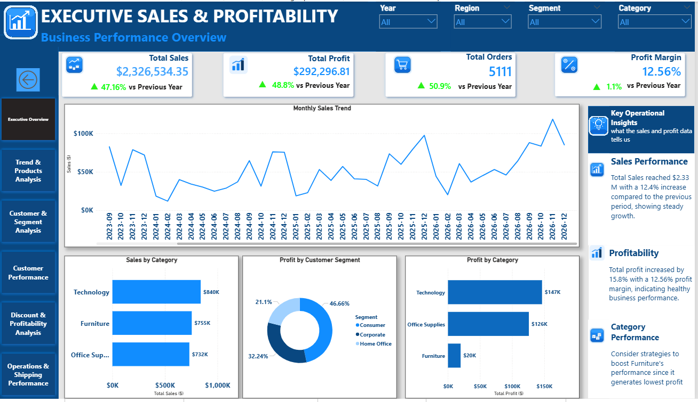
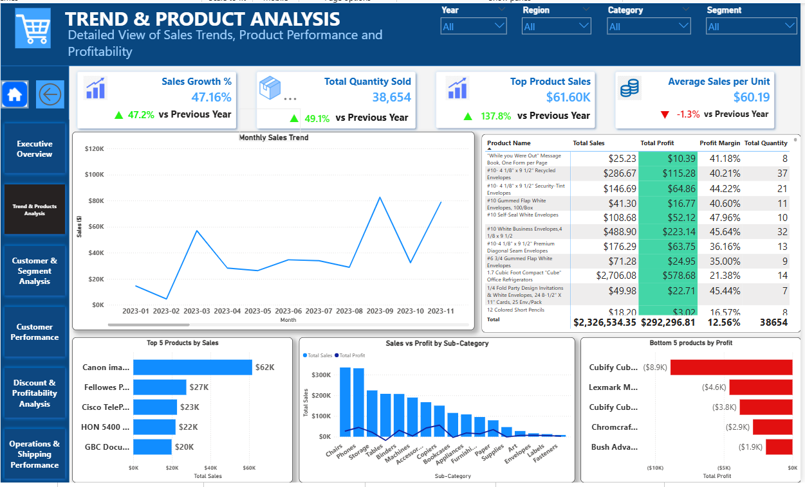
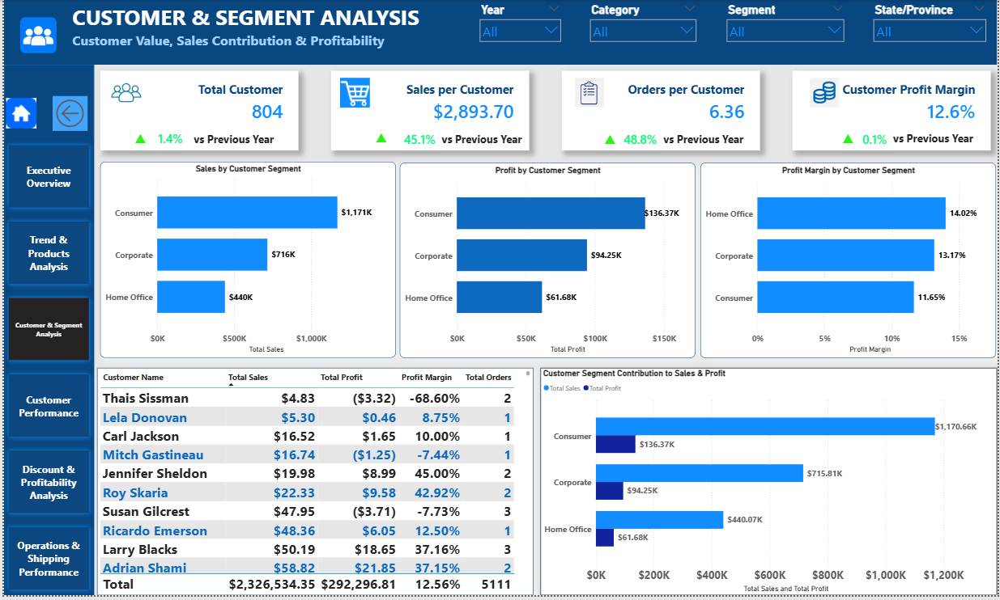
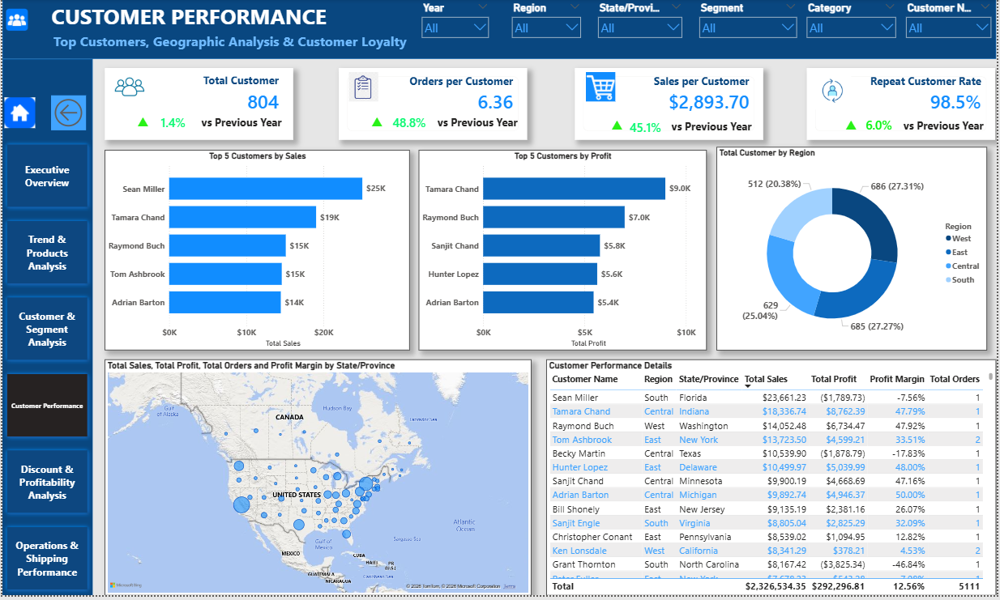
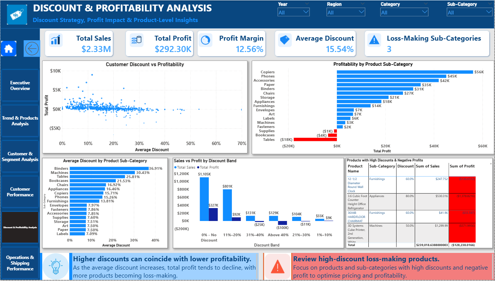
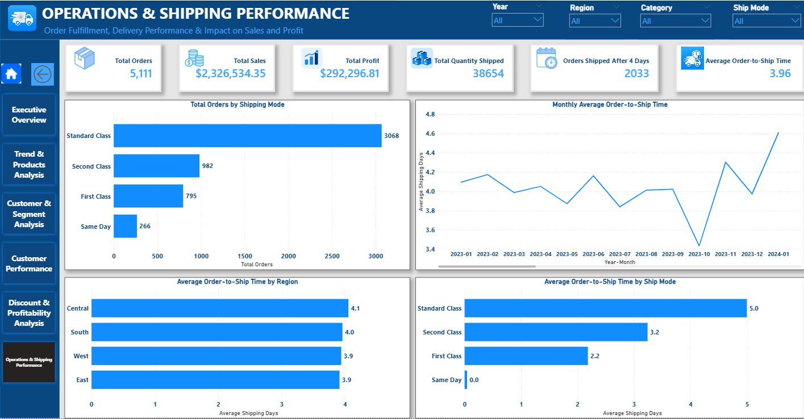

# Retail Sales & Profitability Analysis | Power BI

**An interactive business intelligence project analyzing retail sales, profitability, customer performance, product trends, discount strategies, and shipping operations.**

## 1. Project Overview

This project uses Microsoft Power BI to transform retail transaction data into an interactive business intelligence solution that supports data-driven decision-making.

The report explores sales performance, profitability, customer and product contributions, discount patterns, and order-to-shipment processing time. It presents these areas through six interactive dashboards designed to help users investigate business performance from multiple perspectives.

The analysis helps identify key revenue and profitability drivers, evaluate customer and product performance, assess discount-related risks, and examine order processing efficiency to support informed business decisions.

The project demonstrates practical data analytics skills in data preparation, data modeling, DAX calculations, KPI development, dashboard design, and business performance analysis.


## 2. Business Objectives

The key objectives of this project are to:

- Monitor overall sales, profit, order volume, and profit margin.
- Analyze sales trends and changes in performance over time.
- Compare product categories and sub-categories.
- Evaluate customer and customer segment contributions to sales and profitability.
- Investigate the relationship between discounts and profitability.
- Examine order-to-shipment processing time.
- Develop interactive dashboards that make business performance easier to understand.
- Identify areas requiring further business investigation.

## 3. Data Source

- **Dataset:** Superstore Sales Dataset
- **Source:** [Kaggle — Superstore Dataset Final](https://www.kaggle.com/datasets/vivek468/superstore-dataset-final)
- **File:** `data/Superstore Sales Dataset.csv`
- **Format:** CSV

The dataset contains retail order information relating to customers, products, sales, quantities, discounts, profits, geographical regions, and shipping.

The dataset was imported into Power BI and prepared for analysis. Power Query transformations, data modeling, DAX measures, and calculated columns were used to support the analytical requirements.

**Attribution:** Credit for the original dataset belongs to its respective creator and source. This project focuses on the data preparation, analytical calculations, data modeling, dashboard development, and business analysis.


## 4. Tools & Technologies

| Tool | Purpose |
|---|---|
| Microsoft Power BI Desktop | Interactive dashboards and business intelligence reporting |
| Power Query | Data cleaning and transformation |
| DAX | Measures, calculated columns, and analytical calculations |
| Data Modeling | Relationships between tables and analytical model development |
| CSV | Source data format |
| GitHub | Project documentation, version control, and portfolio presentation |

## 5. Dashboard Gallery

This project contains six dashboards, each focusing on a different aspect of retail business performance.

### 5.1 Executive Overview

Provides a high-level summary of business performance through key performance indicators and summary visualizations.

**Key analytical areas:**
- Total Sales
- Total Profit
- Total Orders
- Profit Margin
- Monthly sales trends
- Sales by product category
- Profit by customer segment
- Profit by category
- Key operational insights



### 5.2 Trends & Products Analysis

Explores sales trends over time and compares product performance to identify patterns and potential opportunities.

**Key analytical areas:**
- Sales trends over time
- Product category comparisons
- Product and sub-category performance
- Identification of strong and weak product areas



### 5.3 Customer & Segment Analysis

Evaluates how different customer segments contribute to sales and profitability.

**Key analytical areas:**
- Customer segment comparisons
- Sales and profit contributions
- Segment-level performance
- Customer purchasing patterns



### 5.4 Customer Performance

Focuses on individual customer performance and their contribution to business results.

**Key analytical areas:**
- Customer sales performance
- Customer profitability
- Customer contribution to overall results
- Identification of high-value customers



### 5.5 Discount & Profitability Analysis

Investigates discounting patterns and their relationship with sales and profitability.

**Key analytical areas:**
- Profitability across discount levels
- Sales and profit comparisons
- Identification of potentially unprofitable discount patterns
- Opportunities for further pricing strategy investigation



### 5.6 Operations & Shipping Performance

Examines order-to-shipment processing time using the available order and ship dates.

**Key analytical areas:**
- Average order-to-ship processing time
- Orders taking more than four days between order and shipment
- Shipping-related operational comparisons
- Indicators of potential processing inefficiencies



**Data limitation:** The dataset contains order dates and ship dates but does not provide actual delivery dates or promised delivery dates. Therefore, this analysis measures the time between order placement and shipment; it does not independently establish whether an order was delivered late.

## Key Findings & Business Recommendations

The Executive Overview dashboard provides an initial view of sales growth, order volume, and profitability.

### Key Findings

### Strong Sales Growth

Total sales reached $2,326,534.35, with reported year-over-year growth of 47.16%.

**Business implication:** Investigate the products, customer segments, regions, and periods contributing most to this growth. Compare sales growth with profit growth and profit margins to assess whether the increase is translating into sustainable profitability.

**2. Profit increased alongside sales**

Total profit reached **$292,296.81**, with a reported year-over-year increase of **48.8%**.

*Business implication:* Management should identify the products and customer segments contributing most to profit and investigate whether the growth is sustainable.

**3. Higher order volume**

The dashboard reports **5,111 orders**, an increase of **50.9%** compared with the previous year.

*Business implication:* The business should assess whether its order-processing and shipping operations can support the increased volume efficiently.

**4. Positive overall profitability**

The reported profit margin is **12.56%**.

*Business implication:* Management should monitor profit margin alongside sales growth to ensure that revenue expansion continues to generate acceptable profitability.

**5. Differences in product category performance**

The displayed category charts show Technology leading category sales and profit in the current dashboard view. Furniture has the lowest profit among the three categories shown.

*Business implication:* Further analysis of product-level margins, discounts, sales volume, and costs could help identify opportunities to improve category profitability.

### Recommended Next Steps

- Investigate the main drivers of year-over-year sales and profit growth.
- Compare category and sub-category profit margins to identify improvement opportunities.
- Review discount patterns alongside product profitability.
- Examine order-to-shipment processing time as order volume changes.
- Validate findings under different year, region, segment, and category filters before making business decisions.


### 5.2 Trend & Products Analysis

This dashboard examines retail sales trends, product performance, and profitability across product categories and sub-categories. It enables users to compare product contributions, monitor changes in sales and quantity sold, and identify products that may require further investigation.

#### Key Performance Indicators

- **Sales Growth:** Displays year-over-year sales growth.
- **Total Quantity Sold:** Measures the total quantity of products sold.
- **Top Product Sales:** Highlights the sales value of the leading product in the current report context.
- **Average Sales per Unit:** Measures average sales value per unit sold.

#### Visualizations and Analytical Areas

**1. Monthly Sales Trend**

Tracks sales over time to help identify changes in performance, fluctuations, and periods of stronger or weaker sales.

**2. Product Performance Table**

Provides a detailed comparison of individual products using metrics such as total sales, total profit, profit margin, and total quantity sold.

**3. Top 5 Products by Sales**

Highlights the five leading products by sales value, helping identify products that contribute substantially to revenue.

**4. Sales vs. Profit by Sub-Category**

Compares sales and profit across product sub-categories to assess whether high sales are accompanied by strong profitability.

**5. Bottom 5 Products by Profit**

Identifies products with the lowest profit or greatest losses in the current report context. This helps prioritize products for further investigation into discounts, costs, pricing, and demand.

#### Initial Observations

- The dashboard reports **47.16% sales growth** in the displayed filter context.
- Total quantity sold is approximately **38,654 units**.
- The leading product by sales has approximately **$61.60K** in sales in the displayed context.
- Average sales per unit is approximately **$60.19**.
- The bottom-products visual highlights products with negative profit, indicating areas that warrant further investigation.

These observations reflect the figures visible in the dashboard screenshot. They should be rechecked against the underlying report and its filters before being used as final business conclusions.

#### Business Questions Addressed

- How are sales changing over time?
- Which products generate the highest sales?
- Which products generate the highest profit or incur losses?
- Are high-sales sub-categories also profitable?
- How do product sales, profit margins, and quantities sold compare?
- Which products may need a review of pricing, discounts, or costs?

#### Business Recommendations

- Investigate the products contributing most to sales and determine whether their profitability is sustainable.
- Review loss-making products to understand the effects of discounts, pricing, costs, and sales volume.
- Compare sales and profit together rather than evaluating product performance using revenue alone.
- Monitor monthly sales patterns to support inventory planning and demand forecasting.
- Use product-level profit margins to prioritize opportunities for improving profitability.


### 5.3 Customer & Segment Analysis

This dashboard evaluates customer value and segment-level performance by examining sales contribution, profit generation, customer profitability, and purchasing activity. It enables users to compare the Consumer, Corporate, and Home Office segments and investigate differences in business performance.

#### Key Performance Indicators

- **Total Customers:** 804 customers in the displayed report context.
- **Sales per Customer:** $2,893.70 in average sales per customer.
- **Orders per Customer:** 6.36 average orders per customer.
- **Customer Profit Margin:** 12.6% displayed customer profitability margin.

The dashboard also presents year-over-year comparisons for the selected measures.

#### Visualizations and Analytical Areas

**1. Sales by Customer Segment**

Compares total sales generated by Consumer, Corporate, and Home Office customers to identify the segments contributing most to revenue.

**2. Profit by Customer Segment**

Compares total profit across the three customer segments to evaluate their contribution to business profitability.

**3. Profit Margin by Customer Segment**

Compares segment-level profit margins to identify differences in profitability relative to sales.

**4. Customer-Level Performance Table**

Provides a detailed view of individual customers using metrics including total sales, total profit, profit margin, and total orders. This supports the identification of high-value customers and customers whose transactions may require further investigation.

**5. Customer Segment Contribution to Sales and Profit**

Displays sales and profit together for each customer segment, allowing users to compare revenue contribution with profit contribution.

#### Initial Observations

- The dashboard reports **804 customers** in the displayed filter context.
- Sales per customer is approximately **$2,893.70**.
- Orders per customer is approximately **6.36**.
- The Consumer segment has the highest displayed sales contribution, at approximately **$1.17 million**, and the highest profit contribution, at approximately **$136.37K**.
- The Home Office segment displays the highest profit margin among the three segments, at approximately **14.02%**. Corporate follows at approximately **13.17%**, while Consumer displays approximately **11.65%**.

These figures are based on the screenshot and should be verified against the underlying Power BI report before being treated as final results. Customer and segment comparisons may change when report filters are applied.

#### Business Questions Addressed

- Which customer segment generates the most sales?
- Which segment contributes the most profit?
- Which segment has the highest profit margin?
- How do customer purchasing activity and sales contribution differ?
- Which customers generate strong sales and profitability?
- Which customer records may require further investigation because of low or negative profit margins?

#### Business Recommendations

- Maintain a strong understanding of the Consumer segment because it contributes substantially to sales and profit in the displayed view.
- Investigate the factors associated with the Home Office segment's higher profit margin to determine whether useful practices can be applied elsewhere.
- Review customer-level profitability before prioritizing customers solely by sales value.
- Investigate customers with negative profit or unusually low margins to understand the effects of discounts, product mix, and transaction costs.
- Use customer and segment performance trends to inform retention, service, and sales strategies.

#### Screenshot


### 5.4 Customer Performance

This dashboard evaluates individual customer performance, geographic sales distribution, and customer loyalty. It combines customer-level KPIs, customer rankings, regional analysis, and detailed performance records to help identify high-value customers and investigate differences in customer profitability.

#### Key Performance Indicators

- **Total Customers:** 804 customers in the displayed report context.
- **Orders per Customer:** 6.36 average orders per customer.
- **Sales per Customer:** $2,893.70 in average sales per customer.
- **Repeat Customer Rate:** 98.5% displayed repeat-customer rate.

The dashboard also presents year-over-year comparisons for the selected metrics.

#### Visualizations and Analytical Areas

**1. Top 5 Customers by Sales**

Ranks customers according to total sales to identify the largest revenue contributors.

**2. Top 5 Customers by Profit**

Highlights the leading customers by total profit, helping distinguish customers who generate revenue from those who contribute strongly to profitability.

**3. Total Customer by Region**

Compares the distribution of customers across the available geographic regions.

**4. Geographic Sales and Profit Analysis**

Uses a map to explore sales, profit, order volume, and profit margin by state or province, supporting geographic comparisons.

**5. Customer Performance Details**

Provides a detailed customer table with fields such as customer name, region, state or province, total sales, total profit, profit margin, and total orders.

#### Initial Observations

- The dashboard reports **804 customers** in the displayed report context.
- The repeat-customer rate is approximately **98.5%** in the current view.
- Average sales per customer is approximately **$2,893.70**.
- The leading customer by sales contributes approximately **$25K** in the displayed view.
- The customer rankings by sales and profit differ, illustrating why revenue and profitability should be assessed separately.
- The geographic visuals provide a way to investigate differences in customer distribution and business performance across locations.

These observations are based on the visible dashboard. The customer rankings and geographic comparisons should be checked against the underlying data and report filters before being treated as final business conclusions.

#### Business Questions Addressed

- Which customers contribute the most sales?
- Which customers generate the highest profit?
- Do the highest-revenue customers also generate the highest profit?
- How are customers distributed across geographic regions?
- How does profitability vary by state or province?
- What proportion of customers qualify as repeat customers under the report's definition?
- Which customer records may warrant further investigation because of negative profit or low margins?

#### Business Recommendations

- Review both customer sales and profit before prioritizing customer accounts.
- Investigate the purchasing patterns of high-value and repeat customers to identify opportunities for retention.
- Examine customer records with negative profits or unusually low margins to understand the contributing factors.
- Use geographic performance patterns to guide further investigation into sales opportunities and regional performance.
- Validate the repeat-customer definition and calculation before using the reported rate in business decisions.

#### Screenshot


### 5.5 Discount & Profitability Analysis

This dashboard investigates the relationship between discounting and profitability across customers, products, and product sub-categories. It combines discount analysis, profit comparisons, discount-band performance, and loss-making product identification to help evaluate pricing and discount strategies.

#### Key Performance Indicators

- **Total Sales:** Approximately $2.33 million.
- **Total Profit:** Approximately $292.30K.
- **Profit Margin:** 12.56%.
- **Average Discount:** 15.54%.
- **Loss-Making Sub-Categories:** 3 displayed in the current report context.

These figures summarize the current dashboard view and may change when filters are applied.

#### Visualizations and Analytical Areas

**1. Customer Discount vs. Profitability**

A scatter plot compares customer discount levels with profit outcomes to help investigate whether higher discounting is associated with weaker profitability.

**2. Profitability by Product Sub-Category**

Ranks product sub-categories by profit and highlights both profitable and loss-making areas.

**3. Average Discount by Product Sub-Category**

Compares average discount levels across sub-categories to identify areas where discounting may warrant closer review.

**4. Sales vs. Profit by Discount Band**

Compares sales and profit across discount ranges to explore how profitability varies at different levels of discounting.

**5. Products with High Discounts and Negative Profits**

Provides a detailed view of products or product sub-categories with high discounts and negative profit, helping prioritize records for further investigation.

#### Initial Observations

- Total sales are approximately **$2.33 million**, with total profit of approximately **$292.30K**.
- The displayed overall profit margin is **12.56%**.
- The average discount is **15.54%**.
- The dashboard identifies **3 loss-making sub-categories** in the current report context.
- The sub-category profit chart shows both profitable and loss-making areas, indicating that performance varies across the product portfolio.
- The discount-band comparison provides a way to investigate whether higher discount ranges coincide with weaker profit outcomes.

These observations are based on the dashboard screenshot. The relationship between discounts and profitability should be verified using the underlying data before making causal claims.

#### Business Questions Addressed

- How do discount levels relate to customer and product profitability?
- Which product sub-categories generate the most profit?
- Which sub-categories incur losses?
- How does average discount vary across product sub-categories?
- How do sales and profit compare across discount bands?
- Which highly discounted, loss-making products warrant further investigation?

#### Business Recommendations

- Review highly discounted products that generate negative profit and investigate their pricing, costs, and sales volumes.
- Evaluate discount strategies using profit and profit margin alongside sales revenue.
- Investigate loss-making sub-categories before introducing changes to pricing or promotions.
- Compare performance across discount bands to identify ranges that may require closer monitoring.
- Avoid assuming that discounts cause losses based on correlation alone; consider product mix, costs, order quantities, and other relevant factors.

#### Screenshot


### 5.6 Operations & Shipping Performance

This dashboard analyzes order volume, shipping methods, and order-to-shipment processing time. It helps explore operational patterns across shipping modes, regions, and reporting periods, providing a foundation for investigating processing efficiency.

#### Key Performance Indicators

- **Total Orders:** 5,111 distinct orders in the displayed report context.
- **Total Sales:** Approximately $2.33 million.
- **Total Profit:** Approximately $292.30K.
- **Total Quantity Shipped:** 38,654 units as displayed by the report.
- **Orders Shipped After 4 Days:** 2,033 orders in the current report context.
- **Average Order-to-Ship Time:** Approximately 3.96 days.

These values reflect the dashboard's displayed filter context and should be validated against the underlying measures before being treated as final results.

#### Visualizations and Analytical Areas

**1. Total Orders by Shipping Mode**

Compares order volume across Standard Class, Second Class, First Class, and Same Day shipping methods.

**2. Monthly Average Order-to-Ship Time**

Tracks changes in average processing time over time to identify periods that may warrant further operational investigation.

**3. Average Order-to-Ship Time by Region**

Compares average processing time across the available regions to identify differences in order handling.

**4. Average Order-to-Ship Time by Shipping Mode**

Compares processing time across shipping methods to explore operational differences between service options.

#### Initial Observations

- The dashboard reports **5,111 orders** in the displayed view.
- Standard Class accounts for the largest order volume among the displayed shipping modes.
- Average order-to-ship processing time is approximately **3.96 days**.
- The dashboard reports **2,033 orders taking more than four days between order placement and shipment**.
- The monthly trend shows variation in average processing time, suggesting that operational performance should be monitored across periods.
- The regional and shipping-mode comparisons provide opportunities to investigate differences in processing time.

These observations are based on the dashboard screenshot. The figures and rankings should be validated against the underlying report and filters before being used as final business conclusions.

#### Business Questions Addressed

- Which shipping methods handle the highest order volumes?
- How long does it typically take for an order to be shipped after placement?
- How does order-to-shipment processing time vary across regions?
- How does processing time differ across shipping methods?
- How many orders take more than four days to reach the shipment stage?
- Are there periods with unusually high average processing times?

#### Business Recommendations

- Monitor order-to-shipment processing time over time to identify unusual changes.
- Investigate orders taking more than four days between order placement and shipment to understand the reasons for longer processing.
- Compare processing time across regions and shipping methods before making operational changes.
- Evaluate shipping-mode selection alongside order volume and processing time.
- Validate operational findings against additional information, such as warehouse capacity, dispatch records, and delivery data, before making service-level decisions.

#### Data Limitation

The source dataset includes order dates and ship dates but does not provide actual delivery dates or promised delivery dates. Therefore, this dashboard measures the elapsed time between order placement and shipment. It does not independently establish whether orders were delivered late or whether delivery commitments were missed.

#### Screenshot


## 6. Key Performance Indicators

The project uses measures and calculations to support business performance analysis.

| KPI | Purpose |
|---|---|
| Total Sales | Measures total sales revenue |
| Total Profit | Measures total recorded profit |
| Total Orders | Counts distinct orders |
| Total Customers | Counts distinct customers |
| Average Order Value | Measures sales value per order |
| Profit Margin | Measures profit relative to sales |
| Total Quantity | Measures total quantity sold |
| Sales per Customer | Measures average sales per customer |
| Orders per Customer | Measures average orders per customer |
| Average Order-to-Ship Time | Measures average days between order placement and shipment |

Additional measures support year-over-year comparisons, customer profitability analysis, and shipping-related analysis.

## 7. Data Preparation & Modeling

The project followed a structured analytics workflow:

1. **Data import:** Imported the source CSV dataset into Power BI Desktop.
2. **Data inspection:** Reviewed available columns and data types.
3. **Data preparation:** Used Power Query to clean and transform data as required.
4. **Date modeling:** Created a date table to support time-based analysis.
5. **Relationship development:** Connected the date table to the retail dataset using the order date.
6. **DAX development:** Created measures and calculated columns to support KPIs and analytical requirements.
7. **Visualization:** Designed dashboards using KPI cards, charts, filters, and supporting insights.
8. **Business analysis:** Used the resulting dashboards to explore performance patterns and potential areas for further investigation.

## 8. DAX Measures & Calculations

Examples of measures and calculations developed for this project include:

- Total Sales
- Total Profit
- Total Orders
- Total Customers
- Average Order Value
- Profit Margin
- Total Quantity
- Sales per Customer
- Orders per Customer
- Customer Profit Margin
- Previous-Year Sales
- Sales Growth Percentage
- Previous-Year Quantity
- Quantity Growth Percentage
- Shipping Days
- Average Order-to-Ship Time
- Orders Shipped After Four Days

Distinct-count calculations are used where appropriate for orders and customers. Additional measures support profitability, customer analysis, and time-based comparisons.

## 9. Interactivity & User Experience

The report uses interactive filters and visual interactions to allow users to explore performance from different perspectives.

Depending on the dashboard, users can analyze results by dimensions such as:

- Year
- Region
- Customer Segment
- Product Category
- Other available fields in the dataset

A consistent visual design and navigation approach helps users move between report pages and investigate specific business questions.

## 10. Key Business Questions

This project supports the investigation of questions such as:

1. How are sales and profits changing over time?
2. Which product categories contribute most to sales and profit?
3. Which customer segments contribute most to profitability?
4. Which customers generate substantial sales or profit?
5. How do discount levels relate to profitability?
6. How long does it typically take for orders to be shipped after placement?
7. Which products, customer groups, or operational areas may require further investigation?

The answers depend on the data and report filter selections. Patterns observed in the report should be interpreted in context and should not automatically be treated as proof of causation.

## 11. Repository Structure

The GitHub repository is organized as follows:

```text
Retail-Sales-Profitability-PowerBI/
│
├── Power-bi/
│   ├── README.md
│   └── Retail_Sales_Profitability_Business_Performance.pbix
│
├── data/
│   ├── README.md
│   └── Superstore Sales Dataset.csv
│
├── screenshots/
│   ├── Customer-Performance.png
│   ├── Customer-Segment-Analysis.png
│   ├── Discount-Profitability-Analysis.png
│   ├── Executive-Overview.png
│   ├── Operations-Shipping-Performance.png
│   ├── Trend-products-Analysis.png
│   └── README.md
│
└── README.md
```


## 12. How to Explore the Project

1. **Preview the dashboards:** Browse the `screenshots/` folder to see the six dashboard pages.
2. **Open the Power BI report:** Navigate to `Power-bi/` and open `Retail_Sales_Profitability_Business_Performance.pbix` using Microsoft Power BI Desktop.
3. **Explore the Executive Overview:** Begin with the main sales, profit, order volume, and profitability KPIs.
4. **Navigate through the dashboards:** Explore product trends, customer and segment performance, discount strategies, and shipping operations.
5. **Interact with the report:** Use the available slicers and visual interactions to analyze performance across the available business dimensions.
6. **Review the supporting documentation:** Read the README files in the `Power-bi/`, `data/`, and `screenshots/` folders for additional project information.

**Requirements:** Microsoft Power BI Desktop is required to open and interact with the `.pbix` report.

## 13. Skills Demonstrated

This project demonstrates practical skills in:

- Data cleaning and transformation
- Power Query
- Data modeling and relationships
- DAX measures and calculated columns
- KPI development
- Time-based analysis
- Sales and profitability analysis
- Customer and product performance analysis
- Discount analysis
- Shipping operations analysis
- Interactive dashboard development
- Data visualization and storytelling
- Business intelligence reporting
- GitHub documentation and project organization

## 14. Business Value

The report provides a foundation for monitoring business performance, investigating sales and profitability patterns, comparing customer and product results, and examining order-to-shipment processing time.

These analyses can support further investigation into pricing decisions, product performance, customer contribution, and operational efficiency. Business actions should be based on validated findings and the wider business context.

## 15. Author

**Joseph Njoroge**

Aspiring Data Analyst | Business Intelligence Enthusiast

This project forms part of my data analytics portfolio and demonstrates my ability to prepare data, develop analytical calculations, design interactive dashboards, and communicate business performance through data visualization.

**Areas of interest:** Data Analytics, Business Intelligence, Sales Analytics, Customer Analytics, and Business Performance Reporting.

---

Thank you for exploring this project. Feedback and suggestions for improvement are welcome.
